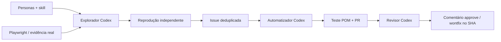

# OrangeHRM AI Audit

Auditoria reproduzível do OrangeHRM com **Codex + Playwright + GitHub**. Três agentes sequenciais analisam evidências, geram testes em Page Object Model e revisam a reprodução do defeito. Projeto adaptado do roteiro original que usava Claude Code.



## Executar

Node.js 22+ e Git. Na raiz do projeto:

```powershell
npm ci
npx playwright install chromium
npx codex login
npm run doctor
npm test
npm run demo
npm run audit
```

`audit` usa Codex autenticado e coleta observações reais sem publicar. Os resultados ficam em `artifacts/explore.json`. Credenciais públicas padrão do demo: `Admin / admin123`. Variáveis opcionais: `ORANGEHRM_BASE_URL`, `ORANGEHRM_USERNAME`, `ORANGEHRM_PASSWORD`. O arquivo `.env.example` é uma referência; variáveis devem ser definidas no shell (não há carregamento automático de `.env`).

Para publicar na sua conta:

```powershell
$env:GITHUB_REPOSITORY = 'LeonardoDH/orangehrm-ai-audit'
# Defina GITHUB_TOKEN no ambiente, sem gravá-lo no repositório.
npm run pipeline -- --publish
```

O token precisa de Contents, Issues e Pull requests com escrita no repositório. O script não cria ou altera repositórios de terceiros.

No Windows, se sua conta já estiver salva no Git Credential Manager, execute `pwsh -File scripts/run-local.ps1`. Esse atalho usa a credencial em memória, executa os três estágios e restaura o ambiente ao terminar. O token GitHub não é repassado ao processo do modelo.

Etapas independentes: `npm run audit -- --publish`, `npm run automate -- --publish`, `npm run review -- --publish`. Sem `--publish`, automate/review ainda leem o GitHub, mas não escrevem nele. `automate` salva o teste localmente. Nenhuma etapa faz merge.

## O que realmente executa

- **Explorador:** percorre doze contratos de login, acessibilidade (axe-core) e navegação; Codex interpreta os resultados à luz das personas e skill. Cada achado selecionado é repetido em um contexto limpo antes da issue. Não há promessa de encontrar 10–15 bugs.
- **Automatizador:** lê issues reconhecidas, reproduz novamente, solicita ao Codex o plano de teste e gera código a partir do contrato POM validado. O gerador é deliberadamente restrito: não executa código arbitrário sugerido por uma issue ou pelo modelo.
- **Revisor:** verifica o conteúdo exato da PR contra o teste canônico, reproduz seu oráculo no navegador e pede uma decisão ao Codex. Publica um comentário `approve` ou `wontfix` vinculado ao SHA revisado. Isso é um parecer técnico, não a aprovação formal do GitHub pela própria conta autora.

As decisões estruturadas do Codex ficam em `artifacts/ai/`. O modelo segue a configuração do Codex instalado; não há dependência do Claude.

`--rules` substitui as decisões da IA por regras explícitas para testar a infraestrutura sem consumir modelo. Esse modo **não é IA**. `npm run demo -- --codex` valida os três agentes reais contra controles sintéticos locais. `npm run demo` executa o mesmo controle com regras. O primeiro teste do demo deve falhar e o segundo deve passar; o comando só termina com sucesso quando os dois resultados são os esperados.

## CI e execução no GitHub

| Workflow | Quando | Validação |
|---|---|---|
| CI | Push, PR e manual | Testes unitários + controle Chromium com defeito/correção, sem segredos |
| Live smoke | Manual | Oito cenários contra o demo público |
| OrangeHRM agent pipeline | Manual | Exploração → issues → PRs → revisão; publicação opcional |

Para o workflow de agentes com `provider=codex`, configure o secret **CODEX_API_KEY** com uma chave própria. A sessão ChatGPT local não é exportada ao GitHub. Com `provider=rules`, não é necessária chave de IA. Para criar PRs com `GITHUB_TOKEN`, habilite **Settings → Actions → General → Allow GitHub Actions to create and approve pull requests**; alternativamente configure **AUDIT_GITHUB_TOKEN** com as permissões acima. PRs criadas pelo token padrão do Actions não disparam automaticamente outros workflows; um PAT próprio permite esse disparo.

CI determinístico é separado do site externo: instabilidade do demo não torna a validação interna artificialmente verde. `npm run test:e2e` inclui testes gerados; eles devem falhar enquanto o defeito real continuar presente. `npm run test:live` executa somente o smoke. Artefatos dos workflows são retidos por sete dias.

## Estrutura

```text
.agents/skills/orangehrm-navigator/SKILL.md  skill descoberta pelo Codex
agents/                                    instruções de cada estágio
personas/                                  perspectivas de uso
skills/orangehrm-skill.md                   mapa e cuidados de navegação
src/catalog.js                             contratos e passos
src/pages.js                               Page Objects e oráculos
src/ai.js                                  execução Codex com JSON Schema
src/pipeline.js                            coordenação sequencial
src/github.js                              issues, branches, PRs e comentários
tests/                                     smoke e regressões geradas
unit/                                      falhas de agentes, duplicação e revisão
scripts/fixture.js                          servidor sintético de controle
.github/workflows/                         CI, smoke e pipeline
```

## Limites e extensão

As personas são perspectivas da sessão Admin, não três contas ou provas de autorização. O demo é compartilhado: os cenários atuais não alteram registros de RH. Timeouts, falhas de rede e seletores quebrados são `inconclusive`, não bugs automáticos. Casos novos devem ser acrescentados ao catálogo e ao POM, com controle que falha e passa. Esta versão é uma auditoria guiada por contratos, não exploração irrestrita de todas as regras de negócio.

Issues são deduplicadas inclusive quando fechadas; PRs também. Achados sintéticos não podem ser publicados pelo CLI. O revisor não executa código arbitrário da PR nem mescla alterações. Screenshots brutos são locais; os achados atuais publicam apenas dados de interface necessários para reprodução.

Referências: [Codex com saída estruturada](https://developers.openai.com/cookbook/examples/codex/build_iterative_repair_loops_with_codex), [Playwright](https://playwright.dev/docs/intro), [demo OrangeHRM](https://opensource-demo.orangehrmlive.com).
